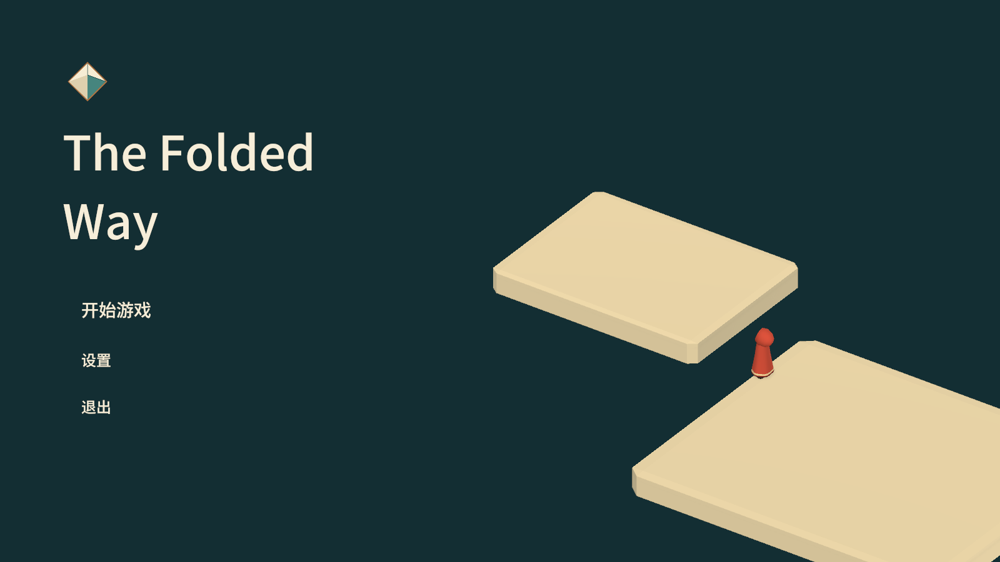
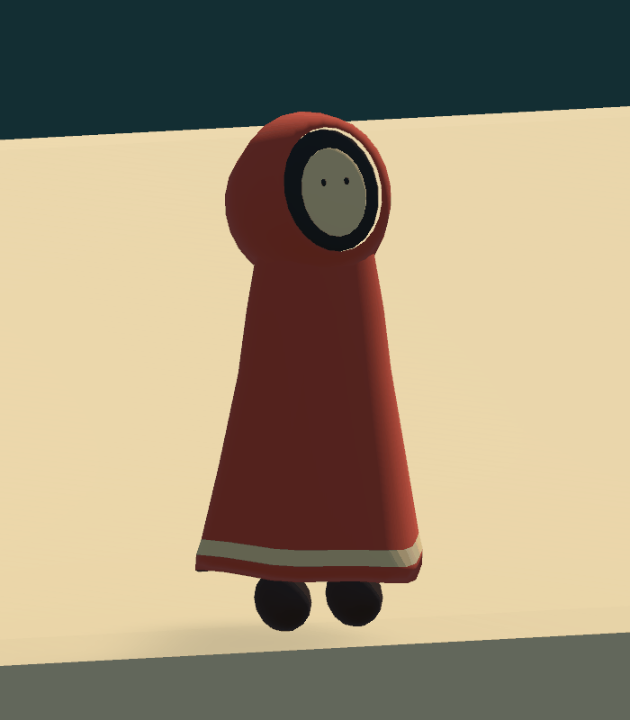

# 主菜单与红斗篷角色

目标：使用现有游戏平台搭建近低远高的主菜单画面，制作可复用的红斗篷角色与循环 idle

主菜单保留 The Folded Way 标题与文字菜单，移除门框、碎平台和云团。右下方使用现有平台作为前景，角色站在边缘望向略靠左上、更高的平台。

角色模型与动画保存为资产和预制体，复用现有 PlayerManager、PlayerController、CharacterController 和空间压缩流程。idle 仅驱动模型形变，不移动碰撞根节点，不引入实时布料模拟或运行时拼装脚本。

- [x] 制作角色模型、材质和循环 idle
- [x] 保存外观预制体并替换现有玩家外观
- [x] 调整主菜单平台、角色与摄像机构图
- [x] 检查动画循环、移动转向、压缩还原和菜单切换
- [x] 查看 Unity 实际画面并记录验证结果

## 角色资源

资源位于 `Assets/Resources/Prefab/Player/Traveler/`，其中 Traveler.prefab 为完整角色，TravelerModel.prefab 为可单独摆放的外观，Model、Material、Animation 分别保存网格、材质和动画

模型包含兜帽、面罩、斗篷、镶边和靴子，共 1406 个顶点、2528 个三角形。单个 SkinnedMeshRenderer 使用形变动画，不需要新增角色控制脚本

Idle 为 4.8 秒循环，控制呼吸与斗篷下摆左右起伏。LookUp 为独立抬头形变，仅用于主菜单，局内角色保持正常朝向。Animator 不启用根运动，脚底顶点不随 idle 位移

可编辑基础网格保存为 `Documents~/Art/Traveler/Traveler.obj` 与同目录材质文件，形变数据保存在 Unity 网格资产中。当前完成简约外观与 idle，移动沿用现有角色控制

## 主菜单

使用原有平台网格，不使用断壁模型、门框或云团。近处平台尺寸为 12×0.8×10，远处平台尺寸为 8×0.8×6，顶面高度分别为 0.4 与 3.2。两平台的水平边界相接，真实高度差形成画面中的断口

MenuTraveler 只包含外观与 Animator，不含 PlayerManager 和碰撞控制。进入关卡后随 MenuRoot 停用，返回菜单后恢复，避免出现额外可控角色

## 验证结果

- 十个关卡逐一加载，均为一个玩家、一个新角色外观，碰撞高度 1.6、半径 0.3 保持不变
- 验证了移动转向、关闭根运动、局内不继承主菜单抬头姿态，以及返回菜单时卸载玩家
- 使用新外观走通第 09 关的无机关路线和机关接驳路线，覆盖升降承载、压缩转向、还原、自然下落、重置与 F 出口推进
- idle 烘焙顶点检查确认斗篷发生形变，脚底与根位置保持不动，首尾姿态一致
- 本次没有增加运行时模型或场景构建脚本

## 实际预览

