# 关卡与机关审查

审查日期：2026-11-06
审查对象：`Game` 场景与 `Level01`—`LevelPkg10` 十个关卡包

## 结论摘要

1. **关卡体量普遍是文档目标的 1.6—6 倍**。第 07 关实际 72×120（目标约 44×40），第 09 关 124×94，第 10 关 148×106（目标约 52×48）。路网只占包围盒的 12%—36%，出现大量 30—60 单位的空廊。
2. **相机一次只能看到约 45×30 的范围**，而关卡宽 60—148。设计文档要求的"入口能看见出口/整体观察"在后几关不成立；第 10 关从出生到出口直线 154.5 单位，约等于 39 秒纯走路，且看不到出口。
3. **机关不是"接缝重叠"，而是实体穿模**。滑桥/升降台顶面与平台顶面共面重叠 7—33 m²；旋转桥的桥体与支路在 90°/270° 扫进岸边平台，部分关卡在初始朝向就已经埋在平台里。
4. **平台表面的摩尔纹不是阴影，也不是 z-fighting**，而是自定义 `Clearance`/`Joined` 网格的顶点法线被侧墙污染：顶面法线 y 只有约 0.01，标准材质把水平面当成垂直面来打光。已重建 39 个网格的法线，当前顶面法线为 (0,1,0)，碰撞体经射线检测仍正常。
5. 现有的 `.csx` 检查只测"静态平台之间的水平顶面"和"岸边的水平三角形"，**不测移动体与垂直岸面**，所以检查通过但游戏里仍然穿模。

---

## 一、关卡体量与节奏

### 1.1 数据对照

文档中的体量目标来自 `Documents~/玩法/后续关卡设计.md`，实际值由关卡预制体实例化后统计。填充率 = 所有道路碰撞体顶面面积 / 关卡包围盒水平面积。

| 关卡 | 文档目标占地 | 实际包围盒 | 填充率 | 出生→出口直线 | 最长单平台 | 机关（实际/文档） |
|---|---|---|---|---|---|---|
| 01 初识折途 | 教学关，无目标 | 72.5 × 28 | 36.3% | 63.7 | 19 | 3 / 3 |
| 02 交点之外 | 紧凑箱庭，无明确数字 | 78 × 48 | 25.3% | 73.2 | 52 | 1 / — |
| 03 四向转角 | 教学关，无目标 | 60.5 × 44 | 32.6% | 31.4 | 32 | 1 / — |
| 04 分岔中庭 | 36 × 32 | 65 × 42 | 34.4% | 38.6 | 28 | 2 / 2 |
| 05 高低之间 | 40 × 36 | 82 × 54 | 26.9% | 43.1 | 52 | 2 / 2 |
| 06 借路回环 | 40 × 32 | 47.5 × 65 | 35.9% | 26.8 | 32 | 1 / 3 |
| 07 错影长廊 | 44 × 40 | 72 × 120 | 14.3% | 105.4 | 52 | 1 / 3 |
| 08 两岸相望 | 44 × 40 | 103 × 44 | 25.6% | 68.9 | 36 | 2 / 3 |
| 09 交错回廊 | 未给数字，强调长廊交错 | 124 × 94 | 12.2% | 117.9 | 46 | 2 / 2（可选） |
| 10 归途之门 | 52 × 48 | 148 × 106 | 14.2% | 154.5 | 60 | 3 / 5 |

这里有两个独立的问题：

- **面积大**：第 04—10 关没有一关落在文档目标附近，越到后面越失控。
- **机关少**：第 06、07 关只做了 1 个机关，文档计划是 3 个；第 08 关 2 个（计划 3 个），第 10 关 3 个（计划 5 个）。体量变大而机关变少，新增的部分主要是走路。

### 1.2 相机与关卡尺度不匹配

`Assets/Scripts/Camera/CameraData.cs` 中：

- 世界模式：`distance = 22`，默认 FOV 60，视线俯角 `worldPitch = 38`
- 平面模式：`flatSize = 13`，即纵向约 26 单位

在目标平面上，一次可见范围大约是 **45 × 30 单位**。第 10 关包围盒 148 × 106，相机只覆盖约 8.6% 的面积；从出生点看，出口完全在视野外。下面的红框是按同一比例叠在关卡俯视图上的相机视野：

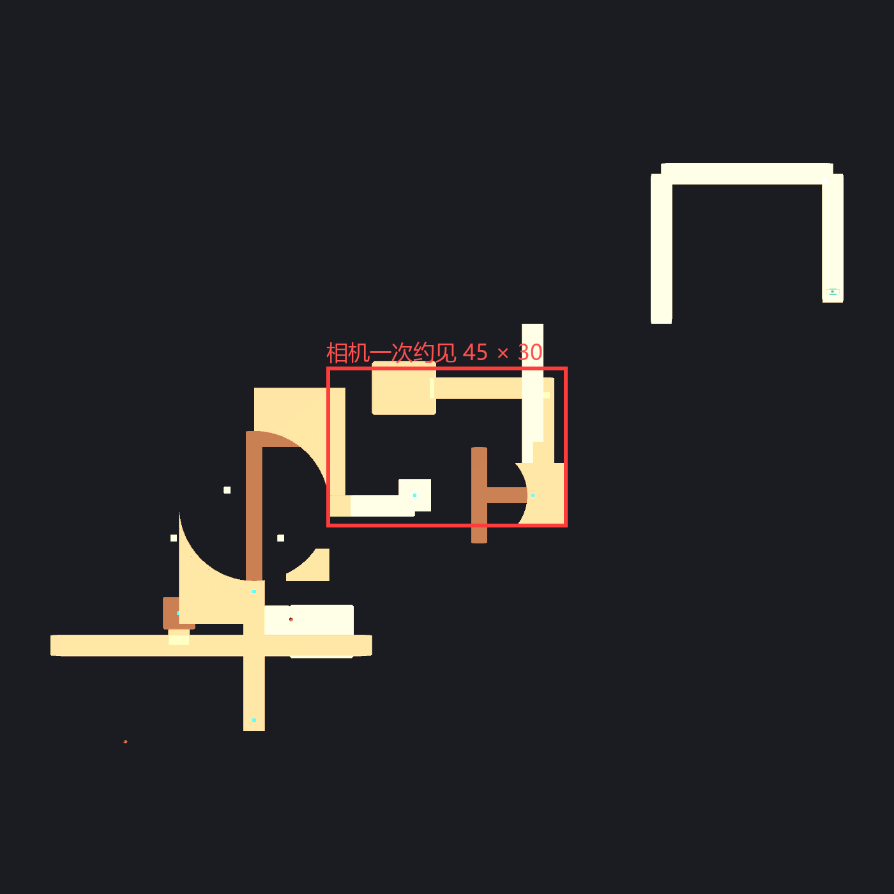

同一关的完整俯视体量：

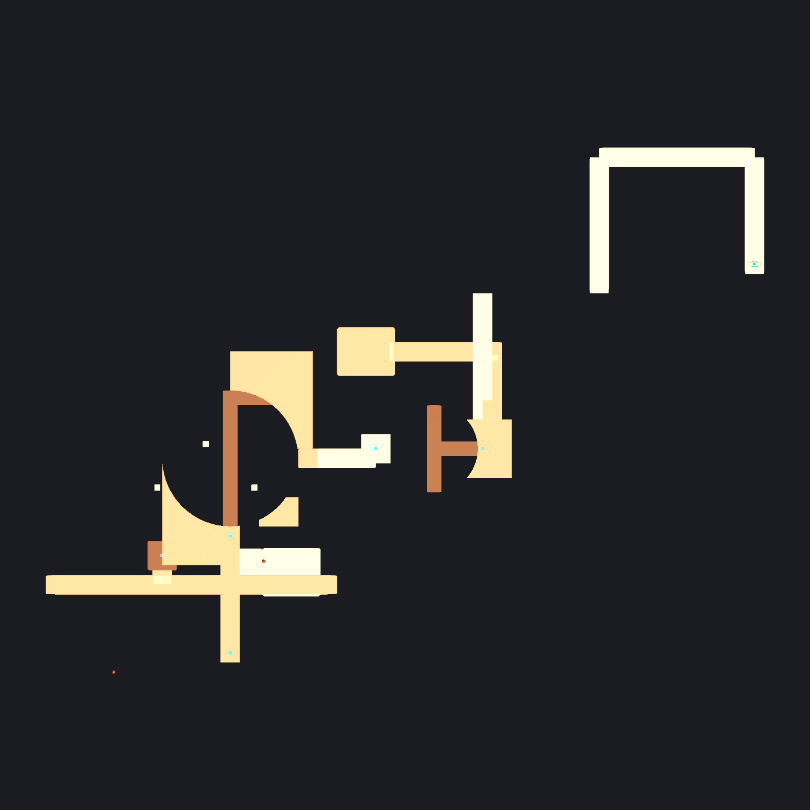

第 07 关同样明显：72 × 120，填充率 14.3%，出生到出口直线 105.4。第 09 关 124 × 94，入口长廊 46 单位、上层长廊 38、外侧长路 32、终点横廊 32。

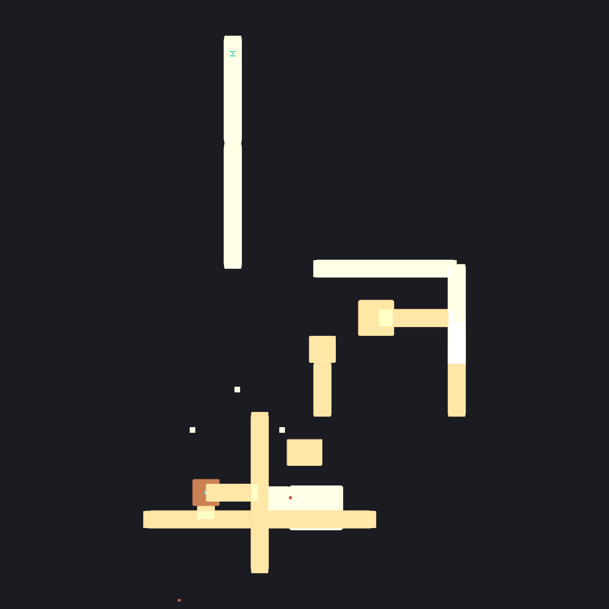

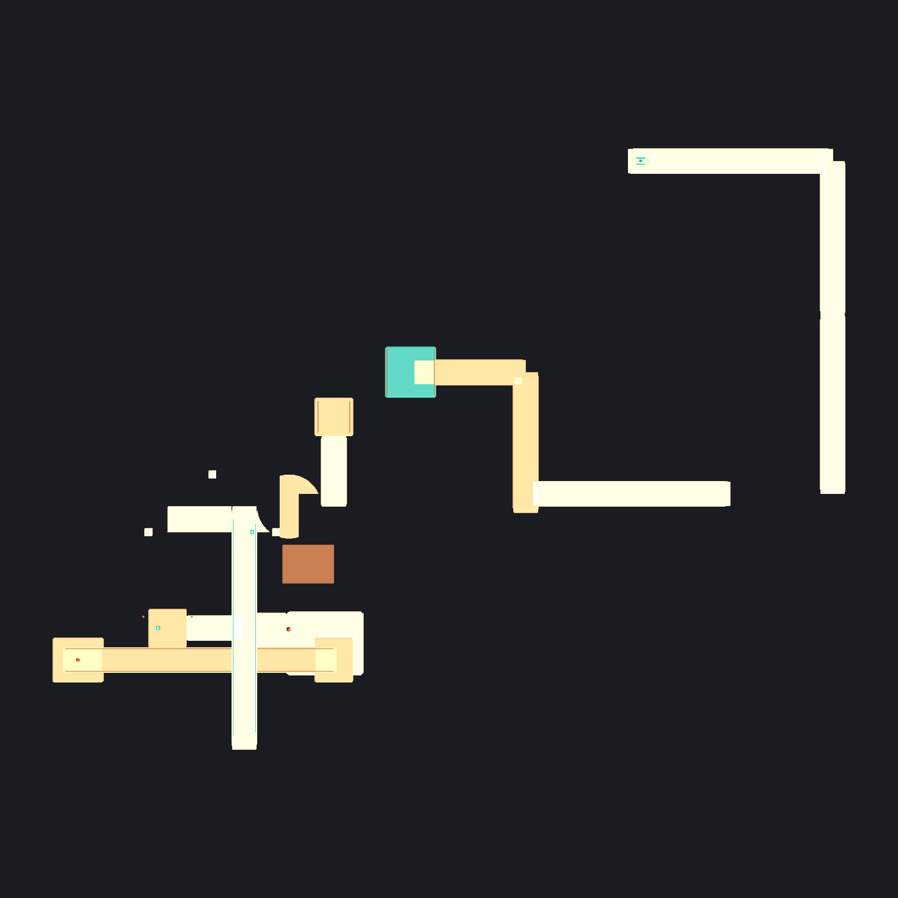

设计文档自己已经写明：

- "路线以 4—8 的单段长度组合，较大体量通过分区形成，不使用一条几十米长的空桥"（`后续关卡设计.md`）
- "单纯增加距离会放大赶路时间，也会让全图投影缩得过小；体量优先体现在区域用途、道路状态和路线变化"

实际关卡里 32—60 单位的单段大量存在，正好违反了这条。以 `moveSpeed = 4` 计算，仅第 10 关出生到出口的直线就要约 39 秒，加上绕行、回头、机关等待和镜头过渡，通关时间很容易被走路占满，而不是被空间判断占满。

### 1.3 视觉与导航

- 绝大多数平台是同一个 `BeveledBox`（1 单位厚、4 单位宽），材质只有 `WarmStone` / `Ivory` 两种；高度变化不靠颜色、轮廓或地标区分，只靠阴影和透视。
- 机关是统一的铜色，这本身很好；但周围道路缺少"这一段属于哪个区域"的视觉提示，长走廊看起来完全一样。
- 固定俯角 38° + 等厚平台 + 大面积同色，导致"哪条路更高、哪条路在下面"很难从画面判断，而这恰好是本作的核心判断。
- 文档要求的"每区使用不同轮廓的地标"基本没有落地：除了出口门框和几根柱子，没有可远距离辨认的塔、拱、桥头或颜色分区。

### 1.4 逐关简评

- **01 初识折途**：步骤清楚，适合教学；但三个练习机关从 x=-14 到 x=40.5，练习区本身就很长。旋转练习桥在 90° 时会切进 `TurnLanding`，教学关里最不该出现穿模。
- **02 交点之外**：唯一机关是可选滑桥；52 单位的入口长廊和 48 单位的交叉长廊让"交点"判断被稀释。建议缩小到 40×30 左右，把滑桥改成主路线的一部分。
- **03 四向转角**：L 桥四向的想法成立，但 90°/270° 时支路扫进 `EastLookout` 和 `NorthLookout`，需要先修净空。32 单位的 `SideGallery` 可以拆短。
- **04 分岔中庭**：T 桥本体在四个停靠状态没有平台穿插（只碰到装饰 `Pivot`），这是十关里机关本体最干净的一关；问题在可选滑桥撞柱子/回廊，以及 65×42 的体量。
- **05 高低之间**：核心路线由 `GalleryLift` + `OptionalSlide` 组成，但两者都与 `LiftConnector` / `UpperGallery` 大面积共面重叠；54 单位纵深和 52 单位长廊让"高低之间"变成"来回之间"。
- **06 借路回环**：同一座桥往返使用的概念很好；但只有 1 个机关，65 单位的 Z 向长度主要靠两条岛链撑起来，实际决策密度低。
- **07 错影长廊**：问题最集中。72×120、填充率 14.3%、出生到出口 105.4，却只有 1 个可选升降台。它更像一条很长的观光走廊，而不是文档里"三条支路改变中央交通结构"的关卡。
- **08 两岸相望**：相反观察面选不同来源的想法值得保留；但 `ChoiceBridge` 初始状态就埋在 `NorthLookout` 里，`OptionalSlide` 的轨道被 `NearShadow` 横穿，核心机关的可读性被几何错误破坏。
- **09 交错回廊**：十关里空间关系最完整的一关，十字交叉、下层承接、可选机关都能读懂；但 124×94 和 46 单位入口长廊仍然过大，两个机关都可以完全不用，主路线容易变成"沿长廊一直走"。
- **10 归途之门**：体量最大、问题最多。148×106、出生到出口 154.5、入口长廊 60；`HighCorner` 初始状态埋进 `HighLanding`，`GateFork` 支路埋进 `GateCourt`，`WestLift` 升进 `LiftConnector`。它现在更像把前九关的零件铺在更大的海面上，需要一次真正的收束。

---

## 二、机关嵌入平台与闪烁

### 2.1 判定方法

对每个关卡预制体实例化后：

- 取每个 `MapMechanism` 的 `movingRoot`，按 `MapMechanism.Tick` 的规则生成四个旋转停靠状态（或平移/升降的起止状态）。
- 把移动网格与所有静态平台网格做三角形相交，记录命中的平台和次数。
- 对同一高度、同一水平投影的顶面三角形计算真实重叠面积（不是包围盒）。
- 再以 5° 采样旋转扫掠，检查移动体是否进入静态平台的扫掠圆盘。

`CROSS` 表示移动三角形与静态三角形真的相交；`TOP-OVERLAP` 表示两个顶面共面且水平投影重叠，这是 z-fighting 的直接来源。

### 2.2 严重：大面积共面重叠

| 关卡 | 机关 / 状态 | 目标平台 | 重叠 | 几何原因 |
|---|---|---|---|---|
| 05 | `OptionalSlide` 到位 | `UpperGallery` | **33.48 m²** | 滑桥 12×3，中心 z=12；画廊 z=10..14，桥面直接塞进画廊 3 单位 |
| 05 | `OptionalSlide` 初始 | `LiftConnector` | **16.74 m²** | 滑桥起点 z=2.5..5.5；接驳廊 z=4..8，起点已埋入 1.5 单位 |
| 02 | `OptionalSlide` 到位 | `FarCourt` | **15.88 m²** | 滑桥终点 z=18.5..21.5；庭院 z=16..24，埋入 3 单位 |
| 10 | `WestLift` 到位 | `LiftConnector` | **13.69 m²** | 升降台 x=-17..-11，接驳廊 x=-14..-2，台面升进接驳廊 3×5 |
| 08 | `OptionalSlide` 初始/到位 | `NearShadow` | **11.16 / 11.14 m²** | 横穿的 4×32 长平台与滑桥轨道在同一高度、同一段 z 上直接相交 |
| 05 | `GalleryLift` 到位 | `LiftConnector` | **6.94 m²** | 台面 x=-15..-9，接驳廊 x=-12..18，3×4 重叠 |
| 07 | `OptionalLift` 到位 | `LiftConnector` | **9.44 m²** | 与第 05 关同型：升降台升进固定接驳廊 |

这些是最明显的闪烁来源：两块不透明顶面在完全相同的 Y 上争夺深度，移动时每个像素的胜负随位置变化，就出现爬动的闪面。

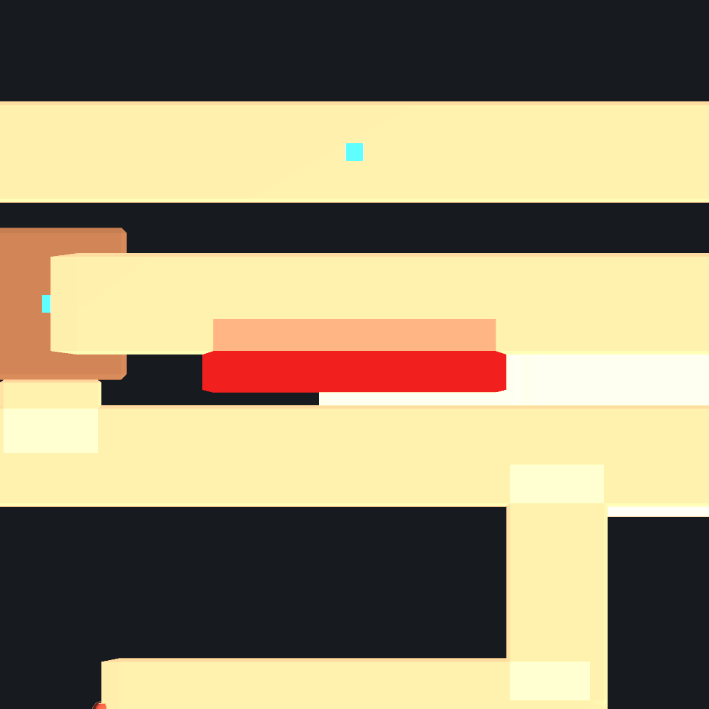

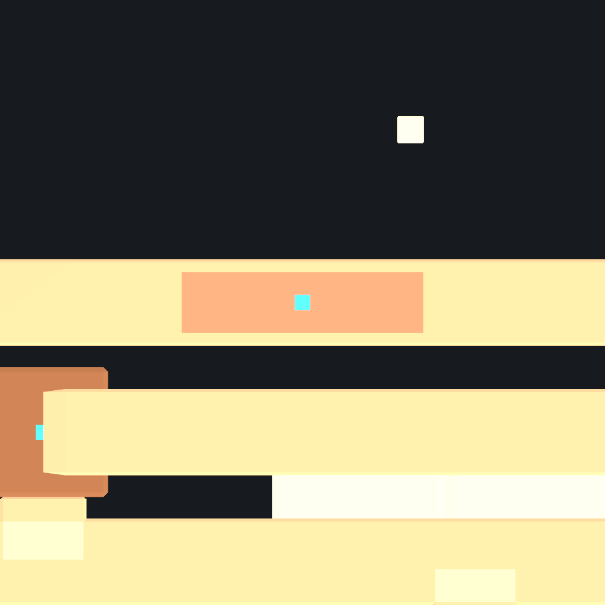

### 2.3 严重：旋转桥扫进岸边平台

| 关卡 | 机关 | 问题状态 | 命中的平台 | 三角形命中 |
|---|---|---|---|---|
| 08 | `ChoiceBridge` | 0° / 90° / 270° | `NorthLookout` | 409 / 371 / 378 |
| 10 | `HighCorner` | 0° / 180° | `HighLanding` / `LiftConnector` + `CrossGallery` | 375 / 276 + 150 |
| 01 | `PracticeRotate` | 90° | `TurnLanding` | 470 |
| 10 | `GateFork` | 0° / 90° | `GateCourt` | 167 / 199 |
| 03 | `CornerBridge` | 90° / 270° | `EastLookout` / `NorthLookout` | 187+121 / 150+61 |
| 06 | `ReturnBridge` | 90° / 270° | `NorthIsland` / `SouthIsland` / `EastLookout` | 121+63+35 / 61+143+40 |
| 04 | `OptionalSlide` | 起点 | `PillarShaft` | 36 |
| 01 | `PracticeLift` | 到位 | `LiftLanding` | 20 |
| 01 | `PracticeSlide` | 起点/到位 | `MiddleCourt` / `PracticeCourt` | 18—20 |

其中第 08 关的 `ChoiceBridge` 在**初始 0° 就已经埋进 `NorthLookout` 0.94 单位**；第 10 关 `HighCorner` 在 0° 时与 `HighLanding` 的水平重叠约 8.66×12，滚出 375 个相交三角形。这不是"接缝没对齐"，而是桥体从平台内部长出来。

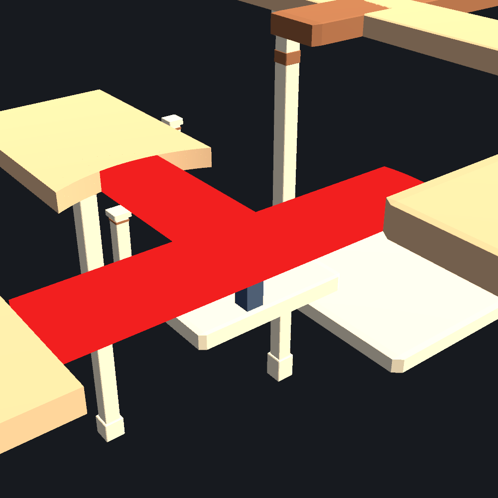

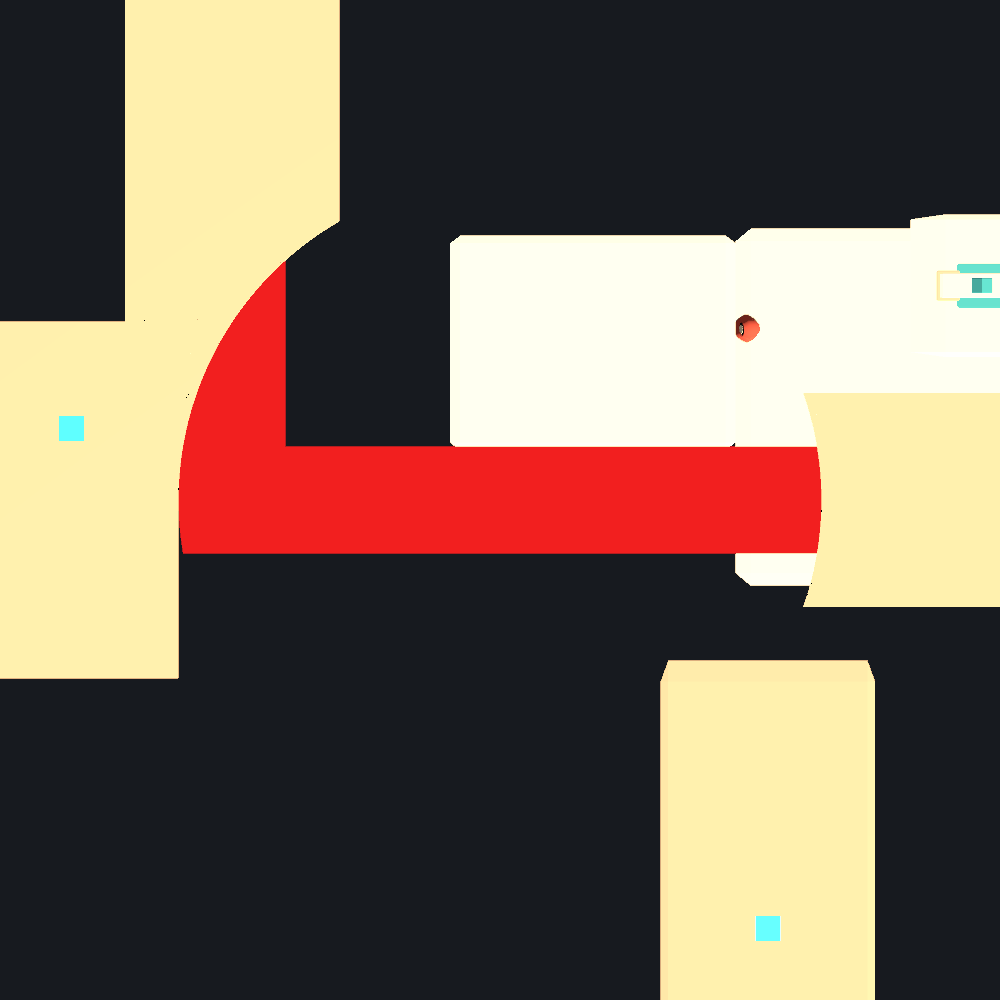

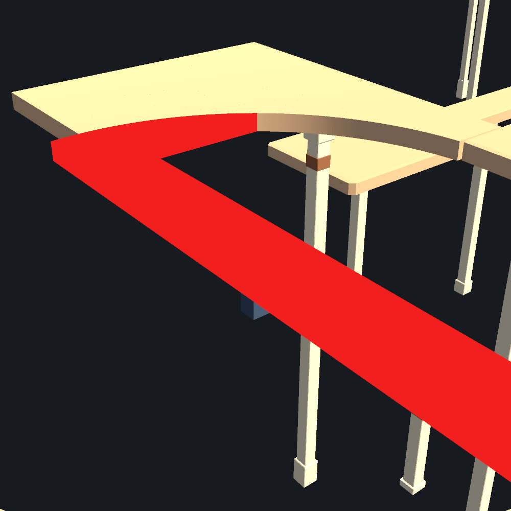

### 2.4 为什么现有检查没有发现

- `Documents~/开发/Checks/RotationClearance.csx`：
  - 半径是硬编码的（`HighCorner=14`、`OptionalTurnBridge=5`、其余 9），不是从当前网格实时求出的扫掠半径。
  - 只取"岸边网格中水平（顶面）的三角形"计算到转轴的距离，**完全不测垂直侧墙、斜面、柱子**。桥体可以在 90°/270° 从岸边的侧壁穿过去，检查仍然通过。
  - 只比较"岸面是否进入扫掠半径"，没有做移动体与静态体的三角形相交，也没有检查停靠状态的顶面共面。
- `Documents~/开发/Checks/StaticClearance.csx`：
  - 只比较静态 `MeshCollider` 之间的共面顶面，跳过 `BoxCollider`，也不包含任何移动中的桥/台/滑桥。
- `TenLevelRoutes.csx`：
  - 验证的是"角色能从 A 走到 B"，不验证沿途几何是否穿插。路线可以通过，画面仍然在闪。

所以文档里"八个转桥 72 个转角采样、固定平台顶面重叠为零"是**正确的但不够**：它只证明了顶面水平三角形没有覆盖，没有证明桥体没有穿过岸墙。

### 2.5 平台表面的摩尔纹（已修复）

在俯视或固定视角下，很多自定义平台表面会出现斜向条纹/漩涡。最初看起来像 z-fighting，但把材质换成纯色后条纹消失，说明不是深度冲突。检查网格法线后确认：

- `CornerBridge_EntryCourt_Clearance` 的顶面三角形面法线是 (0,1,0)，但顶点法线 y 只有 **-0.75..0.49**，大量顶点的法线接近水平；
- `NorthLookout_Joined` 的顶点法线 y 只有 **-0.40..0.46**；
- 原因是顶面顶点与侧墙共享，`RecalculateNormals()` 把侧墙法线平均进来，顶面被标准材质当成垂直面打光，于是出现按三角形排列的高频条纹。

这是**静态平台的闪烁/摩尔纹**，和机关移动无关；它会让整个画面在移动时"沙沙"地闪。修复方式：

- 按三角形角点拆分顶点；
- 每个角点只平均夹角在 35° 以内的相邻面法线；
- 顶面恢复为 (0,1,0)，侧墙仍保留硬边；
- 重建 39 个 `*_Clearance` / `*_Joined` 网格资产。

修复前后对比如下（同一机位、同一灯光）：

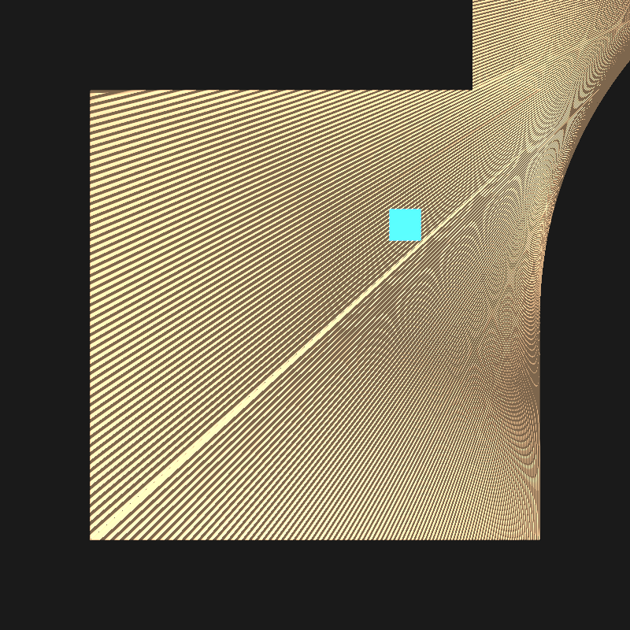

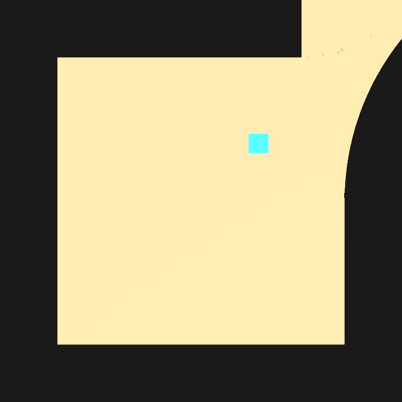

碰撞验证：修复后对 `EntryCourt`、`MechanismRoad`、`NorthLookout`、`EastLookout` 做向下射线，全部命中正确顶面 y=6.00；`MeshCollider` 包围盒与修复前一致。

---

## 三、已做修改

本次只做了**不改变关卡布局和玩法**的修复：

1. 重建 `Assets/Resources/Prefab/Level/*/Mesh` 下 39 个自定义网格的法线，消除平台表面的摩尔纹/闪烁。
2. 新增编辑器工具 `Assets/Editor/LevelMeshNormalFixer.cs`，菜单 `PlaneShift/Fix Level Mesh Normals`，以后新增/修改 Clearance 网格可重新执行。
3. 未修改任何关卡布局、机关位置、`MapMechanism` 参数、相机或 UI。
4. 修复后执行 `TenLevelRoutes.csx` 路线回归：十关主路线与十个出口 F 交互共 198 项操作全部 PASS。这说明碰撞体和路线没有被法线重建破坏；但该测试只证明"能走通"，不证明"视觉上没有穿模"，所以它仍然不能替代移动体-静态体净空检查。

> 回滚：这些网格资产都在 Git 中，可用 `git checkout -- Assets/Resources/Prefab/Level` 取回修改前版本。

---

## 四、修复建议与优先级

### P0：先修"机关实体穿模"，否则关卡无法试玩

1. **第 08 关 `OptionalSlide` / `NearShadow`**
   - `NearShadow` 是横穿滑桥轨道的 4×32 平台，滑桥在起点和终点都与它同高相交。
   - 不能靠上下偏移 2—3 cm 解决：滑桥会整体进入平台体积，角色会被平台挡住。
   - 建议把滑桥轨道移到 `NearShadow` 的一侧，或在 `NearShadow` 上开一个全高的槽（宽度 = 滑桥宽度 + 0.2，长度 = 行程 + 0.4），并重新检查角色从槽两侧的落脚。

2. **第 10 关 `HighCorner` / `HighLanding`**
   - 初始 0° 就重叠 8.66×12，属于布局冲突。
   - 建议把 `HighLanding` 沿 +X/+Z 方向移出 14 单位扫掠圆，或缩短 `HighCorner` 支路并重新检查四个停靠朝向；不要只把桥缩短 1—2 单位，否则其他朝向会出现水平断口。

3. **第 05 关 `OptionalSlide`**
   - 滑桥 12×3，起点 z=2.5..5.5（接驳廊 z=4..8），终点 z=10.5..13.5（画廊 z=10..14）。
   - 建议把起点移到 z=1..4、终点移到 z=7..10，让桥面在两端**贴合**而不是插入：`movingRoot.z` 从 4 改到 2.5，`moveOffset.z` 从 8 改到 6.0。
   - 修改后要实际走一遍"从接驳廊上桥 → 到画廊下桥"，确认两端都能迈上去。

4. **第 03 / 06 / 08 / 10 关的转桥**
   - 转桥的支路在 90°/270° 扫进岸边，不能简单缩短桥体（会产生水平断口，角色不能跳）。
   - 正确做法：在岸边切一个**全高、按扫掠圆修的凹口/插座**，让桥的端部和支路在所有角度都不进入岸体；或者把岸体边缘整体外移穿透深度。
   - 必须同时检查四个停靠状态和 5° 采样的全程扫掠，尤其是 L/T 桥的支路，而不是只检查主梁。

### P1：修"接缝级"重叠

- 第 05 关 `GalleryLift` / `LiftConnector`：把接驳廊西端从 x=-12 缩到 x=-9，让升降台与接驳廊平齐相接。
- 第 07 关 `OptionalLift` / `LiftConnector`：同样处理。
- 第 10 关 `WestLift` / `LiftConnector`：把接驳廊西端从 x=-14 缩到 x=-11。
- 第 02 关 `OptionalSlide` / `FarCourt`：把终点从 z=20 收回到 z=14.5 左右，或把 `FarCourt` 南移，让桥面与庭院边缘相接。
- 第 04 关 `OptionalSlide`：起点避让 `PillarShaft`，终点与 `OuterGallery` / `FarGallery` 只做边缘相接。
- 第 01 关练习区：`PracticeRotate` 与 `TurnLanding`、`PracticeLift` 与 `LiftLanding` 的接缝也需要按 P0 的凹口方式处理；教学关的"正确操作"不应该以穿模为代价。

### P2：关卡体量与路线重做

按文档目标收缩，并优先处理后三关：

| 关卡 | 建议目标 | 主要动作 |
|---|---|---|
| 04 | 约 36 × 32 | 砍掉外围空廊，保留 T 桥中庭 |
| 05 | 约 40 × 36 | 52 单位长廊拆成 4—8 单位段，保留升降 + 滑桥组合 |
| 06 | 约 40 × 32 | 补足第 2、3 个机关，或把岛链缩短 |
| 07 | 约 44 × 40 | 从 72×120 重做，把可选升降改成主路线，增加中段决策 |
| 08 | 约 44 × 40 | 保留"相反观察面"核心，砍掉 36 单位外廊 |
| 09 | 约 60 × 50 | 保留十字/下落/下层回路，46 单位长廊拆短 |
| 10 | 约 52 × 48 | 148×106 整体重排，入口 60 单位长廊必须消失，出口回到视野内 |

同时：

- 每关至少保留 **1 个必经机关**；可选机关只提供捷径/观察点，不能替代谜题。
- 每段路以 4—8 单位为主，用转角、高差、门框、塔、颜色分区形成地标。
- 出口在关键中继平台要可见；如果做不到，说明关卡仍然太大。
- 用实际相机（距离 22、俯角 38°）在游戏内检查可读性，不要只看俯视截图。

### 验证工具建议

把现在的 `.csx` 检查升级为"移动体 vs 静态体"的验证器，至少包含：

- 每个机关的四个停靠状态；
- 5° 采样的旋转扫掠；
- 平移/升降的 0—1 行程采样；
- 移动网格与所有静态网格的三角形相交；
- 同高顶面的真实重叠面积；
- 角色胶囊在移动体和岸边之间的净空；
- 输出关卡、机关、状态、平台名、重叠面积/命中数。

这样"检查通过"才等于"游戏里不会穿模"，而不是只等于"顶面没有共面"。

---

## 五、附：本次审查使用的关键证据

- 平台法线：`EntryCourt` 顶面面法线 (0,1,0)，顶点法线 y 范围 -0.75..0.49；`NorthLookout` -0.40..0.46。
- 机关数据：
  - `OptionalSlide`（第 05 关）：移动网格 12×3×1，起点 z=4，终点 z=12。
  - `LiftConnector`（第 05 关）：x=-12..18，z=4..8。
  - `UpperGallery`（第 05 关）：x=-26..26，z=10..14。
  - `ChoiceBridge`（第 08 关）：0° 时 z=-1.5..9.0，`NorthLookout` z=8.06..19。
  - `HighCorner`（第 10 关）：0° 时 x=-1.5..8.66，z=12..40；`HighLanding` x=0..17，z=28..48。
- 相机：`CameraData.distance=22`、`flatSize=13`、`worldPitch=38`；角色 `moveSpeed=4`。
- 文档体量目标：`Documents~/玩法/后续关卡设计.md`。
- 旧检查：`Documents~/开发/Checks/RotationClearance.csx`、`StaticClearance.csx`、`TenLevelRoutes.csx`。

---

## 六、建议的下一步

1. 先修 P0 的 4 组几何问题（第 08 关滑桥、第 10 关高角桥、第 05 关滑桥、四关转桥净空）。
2. 用实际角色跑一遍主路线，确认没有穿模、没有水平断口、没有把玩家卡进平台。
3. 再整体重排第 07、09、10 关的体量；这三关的"大"不是美术问题，是玩法密度问题。
4. 最后再考虑装饰、地标和颜色分区。

如果只做一件事：**先把第 07、09、10 关缩到文档目标大小**。关卡缩小后，相机能看到更多、空廊变短、机关更容易成为视觉焦点，很多"设计不好"的感觉会自然消失。
