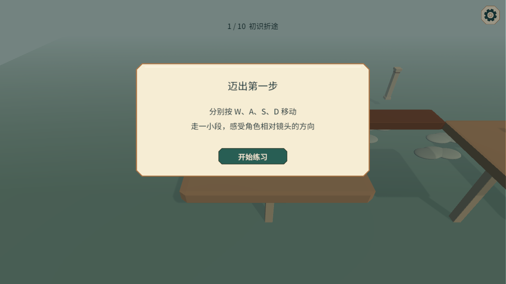
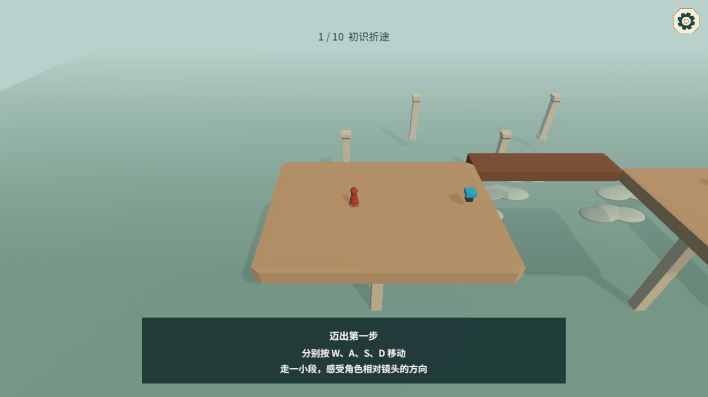

# 十关与引导验收

## 交付范围

Game 场景继续加载十个关卡包，共用 UIRoot。第一关为教学庭院，其余关卡取消原有逐关操作说明。F 交互统一只教学一次。第三、六关使用 L 桥，第四、八关使用 T 桥，第九关保留交错长廊的两条路线并扩展转桥，第十关提供下层折返与高位机关路线。

旋转机关每次同向转动 90 度，四次复原。桥段使用独立道路碰撞，不生成填满 L/T 缺口的包围碰撞。操作台检测盒为触发器，不阻挡道路行走。升降台入口与移动台面接缝分开，避免落脚来源一直归入口。

HelpUI 与 GuideUI 均位于 UIRoot 预制体内，使用 Inspector 引用和持久按钮事件，没有运行时构建界面的代码。阅读显示居中卡片，练习显示底部提示条。开始菜单设置上方增加玩法说明入口。

## 配置入口

| 资源 | 路径 | 内容 |
|---|---|---|
| 初始记录 SO | `Assets/Resources/Config/Record/PlayerRecord.asset` | 说明阅读、引导完成、访问与通关默认记录 |
| 引导 SO | `Assets/Resources/Config/Guide/FirstGuide.asset` | 每步文案与允许的输入 |
| 界面包 | `Assets/Resources/Prefab/Ui/UIRoot/UIRoot.prefab` | 直接关联的菜单、说明、引导和局内 UI |
| 关卡列表 | `Assets/Resources/Config/Level/LevelList.asset` | 十关顺序、标题与选关说明 |
| 关卡包 | `Assets/Resources/Prefab/Level/Level01` 至 `Level10` | 地图、玩家、摄像机和机关实例 |

RecordManager 复制初始 SO，再覆盖 PlayerPrefs 的 PlayerRecord。步骤只有在实际完成后才保存，记录不写回 SO 资产。原 LevelComplete_0 至 LevelComplete_9 通关键继续兼容。

输入模块基于 UnityLightFrame 的 InputManager 与 InputInfo 接入，修正了失活标志未被读取的问题。玩家与空间模块统一读取该入口。引导文案及练习按键可从 SO 调整，动作完成条件保持少量固定类型。

## 验证结果

Unity 中通过实际 PlayerController 逐帧移动验证主线和可选路线。路线中没有用瞬移跨越断路。机关与出口均重新执行玩家目标选择，不设置 LockedTarget 来指定目标，也不直接调用出口方法代替 F 交互。俯视移动遇到无地面区域会回退，与 PlayerManager 的道路限制一致。

| 检查 | 结果 | 复测方法体 |
|---|---|---|
| 十关主路线、出口连续推进及最终完成 | 通过 | `Checks/TenLevelRoutes.csx` |
| 第四关直接接桥路线、按钮与出口重叠、旧目标替换、标题格式 | 通过 | `Checks/FourthLevelExit.csx` |
| 第 05、06、07、09、10 关可选路线 | 通过 | `Checks/OptionalRoutes.csx` |
| 第 08 关相反观察面恢复不同来源 | 东侧接入远端 FarCross，离开其重叠区域后从西侧返回 NearShadow | `Checks/OppositeFaces.csx` |
| 四次旋转方向、中间角度、归位与第二桥段归属 | 通过 | `Checks/MechanismTurns.csx` |
| 首次机关阅读与练习权限、等待运动结束、重进不重复 | 通过 | `Checks/FirstInteraction.csx` |
| 记录持久化、默认值隔离、重复完成、补做前置与暂停叠加 | 通过 | `Checks/GuideLifecycle.csx` |
| 六向镜头跟随、Shift 直接压缩与同路恢复 | 通过，不等待松键，无预览状态 | `Checks/DirectCompression.csx` |
| 六向来源排序与原轴坐标规则 | 32 项通过 | `Checks/CompressionRules.csx` |

另已核对十个包的入口配置、机关目标与缺失脚本；移动练习仅开放 WASD，方向键、Shift、F、R 均不生效，设置开关不会解除当前限制。局内标题改为关号加名称，例如“4.分岔中庭”。第二至第十关增加后半程区域，出口离最近机关按钮超过 15 个单位。

这些检查覆盖行为与通路，难度节奏和提示可读性仍需人工试玩评估，不将自动走通视为谜题体验已定稿。

测试日志位于 Library，不作为游戏资产发布。复测方法体只用于 Unity MCP execute_code，不参与游戏编译。

## 界面预览

阅读阶段：

练习阶段：

