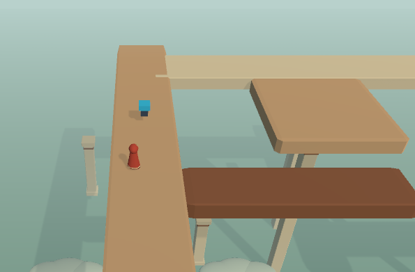
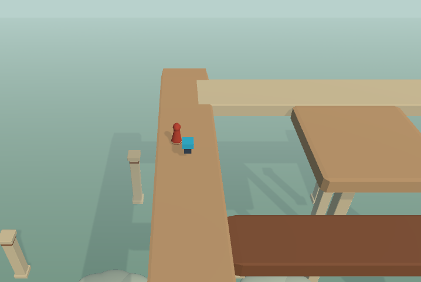
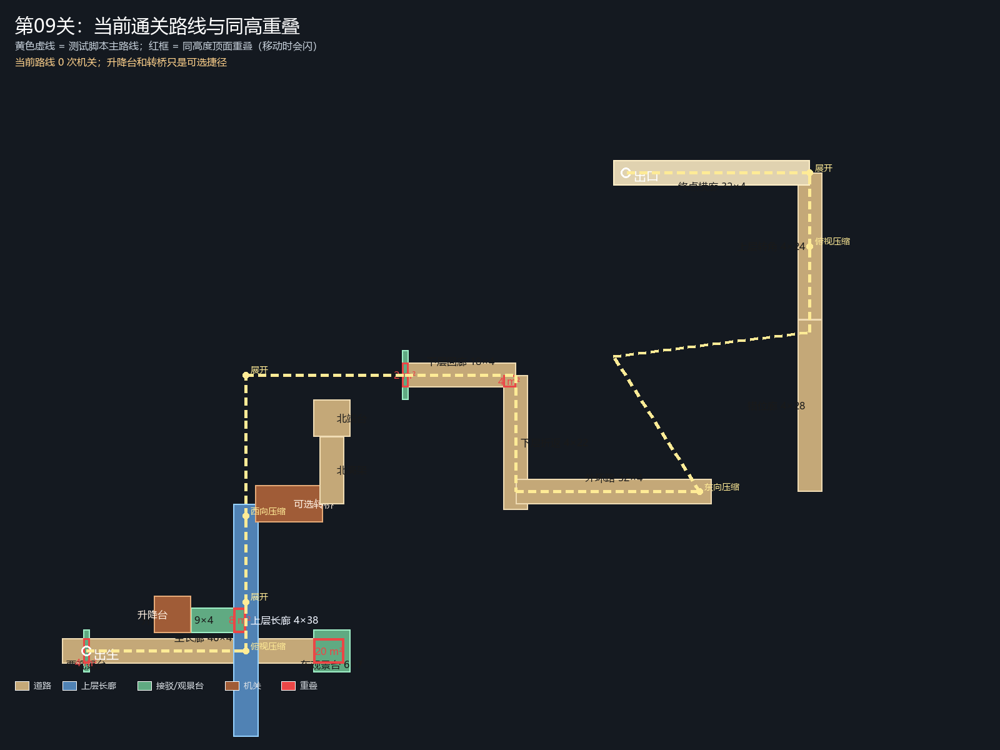
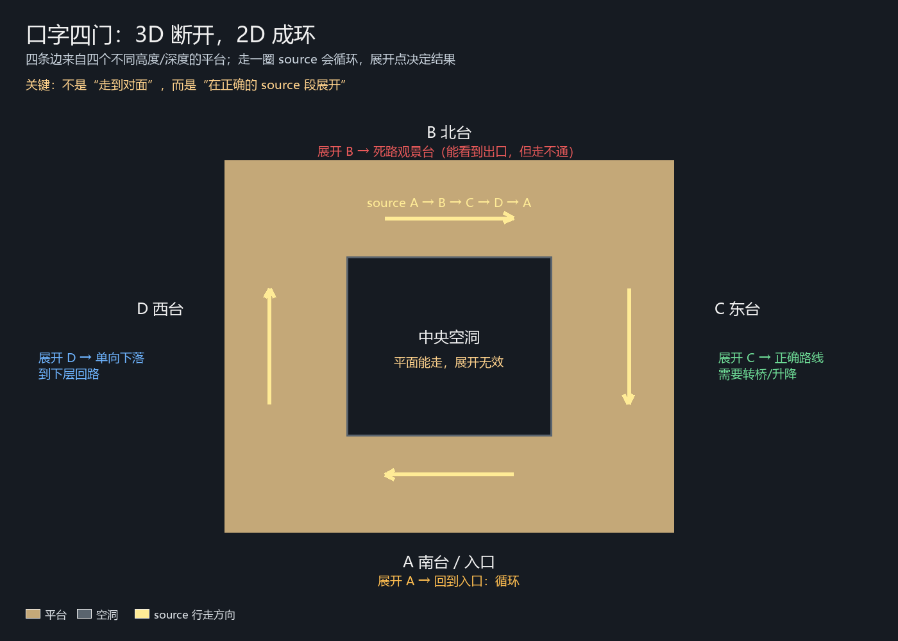

# 第09关：重叠闪烁与难度重设计分析

日期：2026-11-06
对象：`LevelPkg09`（交错回廊）
参考：两张实际游戏截图、`LevelPkg09.prefab` 平台数据、`TenLevelRoutes.csx` 路线记录

## 0. 先确认区域

截图里的“长走廊 + 右侧方形平台 + 下方铜色桥”组合，和第 09 关的上层区域一致；这个区域至少有两组同高度的 BoxCollider 平台重叠，都会在相机移动时 z-fighting：

- `UpperCrossGallery` × `LiftConnector`
- `MainPromenade` × `EastLookout`

两张截图更像是 `UpperCrossGallery` / `LiftConnector` 或 `MainPromenade` / `EastLookout` 的交接处。第 09 关一共有 5 处这种静态重叠，建议一起处理，不要只补截图这一处。





## 1. 闪烁的真正原因

这不是阴影，也不是法线（法线问题上次已经修过），而是**两个静态平台的顶面在完全相同的 Y 上重叠**。

| 平台 A | 平台 B | 重叠尺寸 | 面积 | 共同顶面 Y |
|---|---|---|---|---|
| `MainPromenade` | `EastLookout` | 5 × 4 | **20 m²** | 10.5 |
| `LiftConnector` | `UpperCrossGallery` | 2 × 4 | **8 m²** | 16.5 |
| `MainPromenade` | `WestLookout` | 1 × 4 | 4 m² | 10.5 |
| `LowerGallery` | `LowerReturn` | 2 × 2 | 4 m² | 8.5 |
| `LowerGallery` | `CatchDeck` | 0.5 × 4 | 2 m² | 8.5 |

这些平台都是 `BeveledBox` + `BoxCollider`，不是 `MeshCollider`。旧的 `StaticClearance.csx` 只检查 `MeshCollider` 之间的共面顶面，**把 BoxCollider 全部跳过了**，所以检查显示“零重叠”，游戏里却一直在闪。



## 2. 这组重叠怎么修

### 推荐：边缘相接 + 2 cm 竖向错位

不要用“关闭碰撞/隐藏模型”糊弄，也不要直接重叠 5 米。对静态平台，最稳的做法是：

1. 把主平台缩到与副平台边缘相接：
   - `MainPromenade` 东端从 x=16 缩到 x=11，和 `EastLookout` 西边缘相接；
   - `LiftConnector` 东端从 x=0 缩到 x=-2，和 `UpperCrossGallery` 西边缘相接；
   - `LowerGallery` 东端从 x=44 缩到 x=42，和 `LowerReturn` 相接；西端从 x=26 缩到 x=26.5，和 `CatchDeck` 相接。
2. 为了保证碰撞连续、不出现“看得见但走不过去”的细缝，保留 **0.1—0.2 米** 的重叠，但把次要平台的顶面降低 **0.02 米**。
   - 角色 `stepOffset = 0.15`，2 cm 的台阶完全无感；
   - 两个顶面不再共面，z-fighting 消失；
   - 玩家从主平台走到副平台是“上/下 2 cm”，不会掉下去。

这比“只把一块平台往下挪 2—3 cm”更安全：只挪不裁，重叠面积仍然很大，桥/平台会有一大块埋在另一块里面；裁剪+2 cm 才能同时解决视觉和碰撞。

### 不推荐

- 只降低 2—3 cm、不裁剪：20 m² 的平台会整块埋进去，玩家会觉得平台“缺了一块”。
- 直接缩短到完全不接触：容易留下水平细缝，CharacterController 没有跳跃，可能卡住。
- 把其中一块平台隐藏：会破坏道路来源和投影，绝对不要。

## 3. 为什么这关现在太简单

`TenLevelRoutes.csx` 的第 09 关主路线是：

```text
出生 → 主长廊 → 俯视压缩 → 平面走到交叉 → 展开到上层长廊
→ 西向压缩 → 平面走到北端 → 展开 → 下层回廊
→ 外环路 → 东向压缩 → 展开 → 上层转角 → 终点横廊 → 出口
```

这条路线**一次机关都没有用**。`GalleryLift` 和 `OptionalTurnBridge` 都在主路线之外，完全是可选捷径。

所以这关的实际体验是：

- 两段很长的直廊（主长廊 46、上层长廊 38），中间一个十字；
- 十字的“转向”在俯视压缩后一眼就能看到，不需要反复观察；
- 走错也没有代价，回头沿原路走即可；
- 出口在 100 多单位之外，玩家大部分时间在走路，而不是在推理。

这不是“机关可选”的问题，而是**可选机关 + 连续长廊 + 单向大回路**一起把决策密度压没了。文档里“长廊交错、自己找路线”的目标是对的，但现在的布局只实现了“长廊”，没有实现“找路线”。

## 4. 重设计目标

第 09 关重做后应满足：

1. **至少 1 个必经机关**：升降台或转桥必须用一次，不能沿长廊直接走通。
2. **至少 1 次回头/换路**：玩家要先到侧台观察，再回到交叉点改变路线，而不是一路向前。
3. **至少 1 个“看起来连通、实际不通”的假路线**：例如俯视压缩后看似接上层长廊，落点却是升降接驳台，或者前方是高坎；玩家要展开、绕到侧面才能判断。
4. **出口在交叉点视野内**：从中央交叉可看到出口门框，不需要走 100 单位才发现它。
5. **体量缩到约 60 × 50**：当前 124 × 94，主长廊 46、上层 38、外环 32、终点横廊 32，全部可以砍半。
6. **保留第 09 关的主题**：上下层交错、可选捷径、自然下落；但“可选”只给熟练玩家，不给首次通关。

## 5. 建议的灰盒路线


### 推荐流程

1. **出生 → 中央交叉**
   - 主长廊缩短到约 24 单位；走到交叉点时，俯视压缩看起来能直接接上层长廊。
   - 实际压缩后，落点是 `LiftConnector`（近侧来源），不是上层长廊；或者前方出现 2.5—3 单位的高坎。
   - 玩家必须先展开，离开重叠区，去西侧观景台。

2. **西侧观景台（必经观察点）**
   - 从侧面能看到上层长廊、北高架和转桥的当前朝向。
   - 这里放第一个提示性构图：玩家能看出转桥初始朝向接的是死路观景台，而不是北高架。
   - 观景台不是装饰，是主路线的一站；从观景台回到中央，需要走一小段回头路。

3. **升降台 → 上层长廊**
   - 升降台低位接主长廊，高位接 `LiftConnector`；玩家必须乘它上到上层。
   - 上层长廊缩短到约 20 单位，走到转桥。

4. **转桥：第一次转动**
   - 初始朝向接一个死路观景台（看得见，但走不通）。
   - 玩家在近侧操作台把桥转到北高架方向，过桥到北端。
   - 北高架尽头是单向下落口，落到下层承接台；此时不能原路返回。

5. **下层回路 → 第二次转动**
   - 下层折返长廊回到中央下方，玩家从另一侧的操作台再次转动同一座桥。
   - 第二次转动让桥接到回程/出口方向；玩家从下层回到主长廊的另一侧，展开到出口。
   - 这样同一座桥被用了两次，且第二次是在“走过之后”才看到它的新用途。

6. **出口**
   - 出口放在中央交叉上方或紧邻交叉的平台，从下层回程和中央交叉都能看见。
   - 不再需要走 100 单位到地图边缘。

### 口字四门变体（更接近“走着走着回到原地”）

如果想把“绕”做得更纯粹，可以把中央交叉换成一个 **口字四门**：



- 四条边 A/B/C/D 来自四个不同高度/深度的平台；3D 中四边断开，2D 投影连成环。
- 走一圈时脚下 source 会循环：A → B → C → D → A。
- 四个展开点给四种结果：
  - A 南台：回到入口（短循环，玩家会认出同一个门/地标）。
  - B 北台：死路观景台，能看到出口但走不通。
  - C 东台：正确路线，但需要先转桥/乘升降改变 source。
  - D 西台：单向下落，进入下层回路。
- 中央空洞在平面压缩后会被投影填平，玩家能“走”过去，但展开时没有真实顶面，会展开失败；这比文字教学更直观地说明“平面是投影”。
- 关键不是“走到对面”，而是“在正确的 source 段展开”；四边的高度/深度差异要在 3D 中可观察。

这个变体可以直接替换第 09 关的十字长廊：入口放南台，出口放在东台上方；外圈保留但缩短，整关约 60×50。

### 机关分工

| 机关 | 作用 | 是否必经 |
|---|---|---|
| `GalleryLift` | 主长廊 → 上层接驳台 | 是 |
| `OptionalTurnBridge` | 上层 → 北高架；回程 → 出口方向 | 是，需两次 |
| 可选捷径 | 熟练玩家在交叉处用一次精确压缩跳过升降台 | 可选，但落点必须可见、可返回 |

### 假路线与可恢复性

- **假路线 A**：俯视压缩的“直通”落点是 `LiftConnector`，不是上层长廊；玩家需要展开、走到侧台观察，再重新选择压缩方向。
- **假路线 B**：转桥初始朝向接死路观景台；玩家走过去发现不通，必须回来转桥。死路观景台本身要有价值（能看到北高架和出口），不是纯惩罚。
- **不锁死**：北高架的下落是单向，但下层有连续回路回到中央；转桥两端都有操作台；R 复位仍然可用。

## 6. 具体改动清单

### P0：静态重叠（先做，不影响路线）

- `MainPromenade` 东端 16 → 11，和 `EastLookout` 相接；`EastLookout` 顶面降低 0.02。
- `LiftConnector` 东端 0 → -2，和 `UpperCrossGallery` 相接；`LiftConnector` 顶面降低 0.02。
- `LowerGallery` 东端 44 → 42，和 `LowerReturn` 相接；西端 26 → 26.5，和 `CatchDeck` 相接。
- `WestLookout` 顶面降低 0.02，或把它缩到不与主长廊重叠。
- 新增一个静态重叠检查器：**必须包含 BoxCollider**，不能只检查 MeshCollider。

### P1：堵掉零机关路线

- 在 `MainPromenade` 与 `UpperCrossGallery` 的交叉处加一个 2.5—3 单位的高坎或缺口，让“俯视压缩直接走通”不成立。
- 把升降台低位接到主长廊、高位接到 `LiftConnector`；确保玩家必须乘台。
- 把转桥初始朝向改成只接死路观景台；北高架必须通过一次旋转才能到达。

### P1：加入回程与第二次机关

- 北高架尽头加下落口到 `CatchDeck`；下层折返回路接回主长廊西侧。
- 在转桥的另一侧加第二个操作台，引用同一个 `MapMechanism`，让玩家在下层也能改变桥向。
- 回程路线使用转桥的第二次朝向，让玩家看到“前面那次操作改变了现在的地形”。

### P2：缩体量与可读性

- 主长廊 46 → 约 24；上层长廊 38 → 约 20；外环路 32 → 约 18；终点横廊 32 → 约 16。
- 整关从 124 × 94 缩到约 60 × 50。
- 中央交叉加一个高塔/门框地标，出生点和下层回路都能看到。
- 上下层用不同材质/高度带；出口在交叉处可见。
- 保留云、柱子和海面，但不要让装饰占据主路线视野。

## 7. 验证顺序

1. 先修 P0 静态重叠，进游戏沿截图区域走一遍，确认不再闪。
2. 加 P1 高坎/假路线，确认零机关路线确实走不通，且玩家能通过观察找到替代路线。
3. 改 P1 转桥/升降，确认两次机关操作都有可见后果，且不会卡死。
4. 最后缩体量、加地标；用实际相机（distance 22、pitch 38°）检查可读性。
5. 跑 `TenLevelRoutes` 之后的新路线脚本；同时保留一条“熟练玩家捷径”，但不要让它成为唯一解。

## 8. 结论

- 截图这块的闪烁是 **BoxCollider 静态平台同高重叠**，不是阴影；第 09 关有 5 处，最大 20 m²。
- 这关现在太简单，不是因为机关少，而是因为 **主路线完全绕开了两个机关**，而且两段长廊太长、没有必须回头的观察点。
- 推荐的改法不是“把路加长”，而是：**先修重叠，再用一个高坎/假来源把玩家逼去侧台观察，用升降台和转桥各卡一次，最后用下层回路把玩家送回出口**。这样关卡会变“绕”，但不会变成纯走路。
