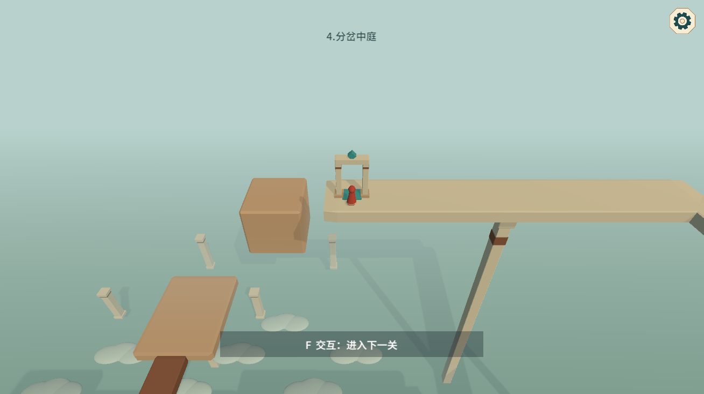

# 关卡扩展与出口

## 出口交互

局内标题采用“4.分岔中庭”的形式，不显示关卡总数。

出口与操作台分开布置，终点区域不再放置机关按钮。交互检测会重新比较范围内目标：优先选择可用目标，可用出口优先于机关，同级目标选择距离最近者。教学期间仍保持指定目标，不将完成机关教学误处理成离开关卡。

## 后半程路线

第一关保留完整教学流程。第二至第十关将原终点区域改为中继点，增加后半程回廊，再设置新的出口。

| 关卡 | 新增结构 | 主要判断 |
|---|---|---|
| 02 交点之外 | 横向长廊、高位折返、终点侧廊 | 在长路尽头重新判断相邻道路的展开位置 |
| 03 四向转角 | 侧向长廊、远端高架、反向回廊 | 转桥只解决前段，抵达远端后仍要重新组织路线 |
| 04 分岔中庭 | 缺口桥、上层旁路、高位折返、终点回廊 | 平移桥可直接填补缺口，也可通过压缩绕行；抵达对岸后继续寻找高处回路 |
| 05 高低之间 | 西侧长廊、向北高架、回程横廊 | 原上下双路作为前段，远端再衔接一次跨层转向 |
| 06 借路回环 | 后侧长路、高位横廊、向内折返 | 原两条走法在中继区汇合，再进入新的折返回路 |
| 07 错影长廊 | 外侧延伸、向西回廊、错位折返、上层终点 | 先通过连续道路远离原下落区，再利用另一方向的错位道路折返 |
| 08 两岸相望 | 东侧长廊、远端错位高架、上层返回 | 相反方向可能回到近侧旧路或进入远侧新路；抵达远侧后仍需换向 |
| 09 交错回廊 | 外侧长路、远端错位廊、上层转角、终点横廊 | 保留前段零机关与机关路线，再组合水平与上下方向进入新的终点区域 |
| 10 归途之门 | 门厅后路、对岸回廊、更高返回路、终点庭院 | 原门厅作为中继区，两条旧路线汇合后仍需完成一次外侧回环 |

新增区域沿用原有平台、柱体、材质及压缩规则，不增加隐藏传送或通关机关次数要求。机关并非全部必须使用，路径长度也不只通过加长一段直路实现。

## 第四关缺口

缺口位于外侧道路 x=24 至 x=34，路面高度 10。平移桥初始偏离道路，操作台位于前段平台，不在出口处。

上层旁路通过两段连接路和一段横廊绕过缺口。玩家可以在二维状态下经过旁路，进入对岸独有区域后再展开，也可以调整平移桥后直接在三维中通过。两条路线随后共同接入高处折返区。

新出口位于 (18,22,12)，原出口位置 (16,10,-16) 只作为路线中继点。

## 布局边界

- 新增道路必须同时检查三维通路与各观察面下的投影来源
- 不让后半程道路意外抢占前段已经明确的下落承接来源
- 后半程应提供转向、换路或展开位置的判断，不以反应速度补充难度
- 出口交互验收必须经过玩家的目标选择与交互入口，不直接调用出口来代替 F 交互

## 终点界面

