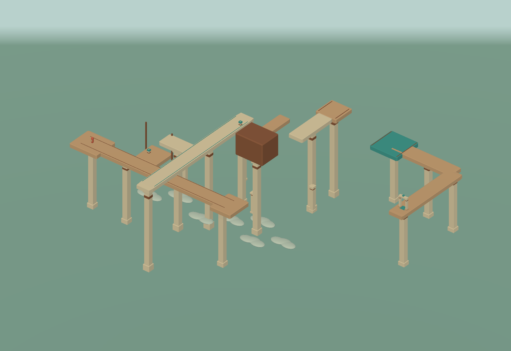
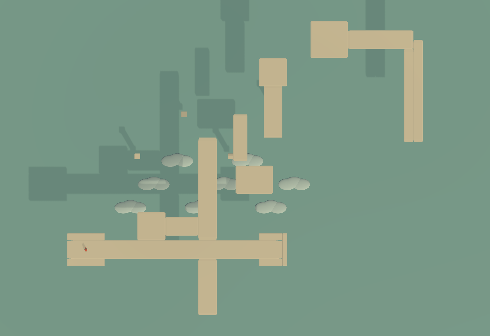

# 第 09 关：交错回廊

## 目标

将原第 09 关替换为长廊交错的空间箱庭，保留 LevelPkg09、Game 场景和现有关卡切换入口。主要谜题由道路之间的投影关系形成，升降台和旋转桥提供可选路线，不检查机关操作次数。

## 空间结构

入口长廊东西延伸约 46，脚底高度 10.5；上层长廊南北延伸约 38，脚底高度 16.5。两条路在三维交错通过，俯视压缩后形成十字路口。玩家可以沿原长廊持续探索，也可以在平面交叉处转向，走出重叠区域后展开到另一条路。

上层长廊旁有升降台和接驳廊。升降台低位与入口长廊相接，高位与接驳廊相接，形成不依赖压缩的上楼路线。

上层长廊与北侧高架在东西方向错开。旋转桥转到位后可直接三维通行；不操作旋转桥，也可压缩 X 轴接入北侧高架。

远处的厚高台与上层长廊错开，在三维中不挡路；压缩 X 轴后，厚高台投影到长廊前方，成为无法迈上的高坎。玩家需要先展开，在三维中沿长廊绕过它，再从更北的位置压缩。

北侧高架尽头下方有东西错位的承接平台。X 压缩后，断口与下层平台对齐，角色可向前走下断口，落到下层。下层是一段连续折返长廊，既能展开后绕行，也能继续利用侧向投影缩短路线。

下层折返区继续连接外侧长路。远端另有水平错位的回廊，玩家需要重新选择观察方向接入，再沿上层转角返回终点横廊。原下层终点作为中继点，不放置出口。

## 关键尺寸

坐标以道路顶面为准，厚度另列。最终资源以预制体内配置为准。

| 对象 | 顶面中心 | 尺寸 X×厚度×Z |
|---|---|---|
| 入口长廊 | (-7,10.5,0) | 46×1×4 |
| 上层长廊 | (0,16.5,5) | 4×1×38 |
| 升降台低位 | (-12,10.5,5) | 6×1×6 |
| 上层接驳廊 | (-4.5,16.5,5) | 9×1×4 |
| 远侧高坎平台 | (10,20.5,15) | 8×6×6 |
| 北侧高架 | (14,16.5,29.5) | 4×1×11 |
| 北端平台 | (14,16.5,38) | 6×1×6 |
| 下层承接台 | (26,8.5,45) | 8×1×8 |
| 下层横廊 | (35,8.5,45) | 18×1×4 |
| 下层回廊 | (44,8.5,34) | 4×1×22 |
| 外侧长路 | (60,8.5,26) | 32×1×4 |
| 远端错位廊 | (92,8.5,40) | 4×1×28 |
| 上层转角 | (92,18.5,66) | 4×1×24 |
| 终点横廊 | (76,18.5,78) | 32×1×4 |

出口位于 (62,18.5,78)。入口出生点位于 (-26,10.5,0)。

## 可选路线

### 不操作机关

沿入口长廊前行，俯视压缩后在交叉处转向上层长廊，离开中心重叠区域后展开。在三维中越过高坎的对应位置，再压缩 X 轴接入北侧高架。走到北端断口后落入下层承接台，展开沿折返长廊到达出口。

### 三维接驳

从入口长廊登上升降台，到高位后经接驳廊进入上层长廊。操作旋转桥连通北侧高架，直接在三维中走过去，再选择压缩后的下落路线。

升降台、旋转桥可以分别使用，也可以全部不用。不把看见按钮作为下一步答案。

## 边界

- 高坎只在保留高度的侧向压缩中形成，上下压缩仍然消去所有高度差
- 交叉中心不强制切换来源，离开原道路的重叠区域后，分支的落脚来源应明确
- 下落保留重力，不使用传送触发器或隐藏落点修正
- 承接台具有足够宽度，落点从观察视角中可辨认
- 不增加墙面重力、强制步骤、钥匙、计时或检查点

## 制作与验收

- [x] 替换 LevelPkg09 中的道路、机关和环境布置
- [x] 更新第 09 关标题、简介与非答案式入口提示
- [x] 验证无机关路线与三维机关路线
- [x] 验证长廊连续行走、十字路口转向与展开来源
- [x] 验证侧向高坎确实阻挡、三维绕行可通过
- [x] 验证断口自然下落、下层承接、出口与重置
- [x] 检查资源引用与预览画面，记录实际试玩边界

## 验证结果

Unity 中使用实际角色控制器逐段移动，已走通零机关路线和操作两组机关的接驳路线。入口长廊可从出生点连续走到东侧；俯视交叉转向后，可展开到上层长廊。

侧向高坎将角色阻挡在 z 约 11.68，展开后沿三维长廊能通过相同区段。从西侧观察并压缩 X 轴，北端自然下落约 8 个高度单位，落脚来源为 CatchDeck，展开后位于 (26,8.5,45) 附近。没有使用落点传送或隐藏触发器。

下层承接台与回廊的投影存在重叠。从西侧观察时，承接台优先；从东侧观察时，回廊优先。当前落脚的原道路始终保留优先权，其他道路按所选观察面的近侧排序。在原道路展开时保留压缩前被消去的轴坐标，换到其他道路后再按新道路恢复。

下层三维绕行与侧向压缩折返都能抵达中继点，再经外侧长路、错位廊与上层转角进入终点横廊。出口通过玩家目标选择和 F 交互推进第 10 关，不直接调用出口方法代替玩家操作；测试后恢复通关进度和时间倍率。

关卡布局不依赖额外的传送逻辑。交叉中心按压缩来源优先级处理，正常路线在离开重叠区后展开。人工试玩仍需评估落点可读性、提示力度和长廊节奏。

## 预览

三维布局：

同一关卡的俯视压缩，入口长廊与上层长廊形成十字路口：

